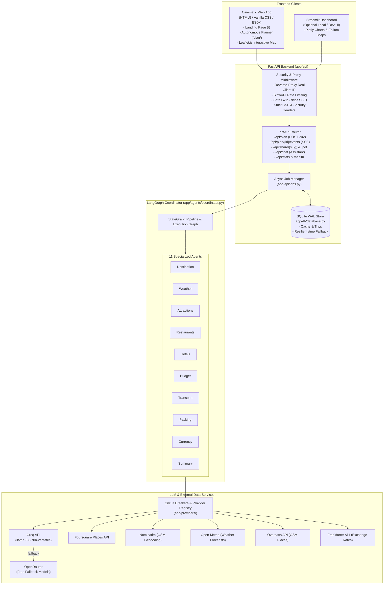

# ✈️ AI Travel Planner Agent (Aetheria)

[](https://github.com/rajadityaaa/Resilient-AI-Trip-Planner/actions/workflows/ci.yml)
[](https://ai-travel-planner-fi31.onrender.com)
[](#-running-tests)
[](https://github.com/astral-sh/ruff)
[](#-deployment--production-operations)
[](LICENSE)

A multi-agent, autonomous AI travel planning platform that orchestrates an **11-agent LangGraph workflow** to generate complete, personalized itineraries — curated sights, local cuisine, hotel tiers, budget breakdowns, transit guides, packing checklists, live weather, and currency conversions.

Built entirely on **100% free-tier APIs and open-weights LLMs**, served via an asynchronous **FastAPI** backend with SQLite persistence and a cinematic, responsive **HTML5/CSS3/ES6+** web interface alongside an optional **Streamlit** dashboard.

> 🌐 **Live Deployment**: **[https://ai-travel-planner-fi31.onrender.com](https://ai-travel-planner-fi31.onrender.com)**  
> - **Cinematic Showcase**: [`/`](https://ai-travel-planner-fi31.onrender.com/)  
> - **Autonomous Planner**: [`/plan/`](https://ai-travel-planner-fi31.onrender.com/plan/)  
> - **Interactive API Docs (Swagger UI)**: [`/docs`](https://ai-travel-planner-fi31.onrender.com/docs)  
> - **Health Probe**: [`/health`](https://ai-travel-planner-fi31.onrender.com/health)  
> - **Platform Observability**: [`/api/stats`](https://ai-travel-planner-fi31.onrender.com/api/stats)  

---

## 🧠 Why This Project

Most "AI travel planner" prototypes are simple single-prompt chatbot wrappers. This project is a genuine **production-engineered multi-agent system**:
- **Specialized Responsibility**: 11 dedicated agents each handle one domain (geocoding, weather forecasts, POI fetching, restaurant rankings, budget calibration, and synthesis).
- **Fault-Tolerant & Self-Healing**: Resilient circuit breakers, exponential backoff, and graceful fallbacks ensure that upstream free-tier API failures (such as Overpass timeouts) never crash the pipeline.
- **Anti-Hallucination Guardrails**: The Summary Agent is strictly constrained to a **closed list** of verified places fetched by earlier agents. A Python-side validator cross-checks output to prevent invented landmarks.
- **Real-Time Streaming**: Server-Sent Events (SSE) stream stage-by-stage pipeline progress and heartbeat comments to the browser without buffering.
- **Micro-Footprint Docker Deployment**: Optimized multi-stage build using `python:3.13-slim` that consumes only **~45 MiB baseline / < 90 MiB peak RSS** during real planning runs, operating comfortably within Render's 512 MB free-tier limit.

---

## 🏗️ Architecture



---

## 🤖 The 11 Specialist Agents

| Agent | Module | Responsibility | Primary Data Source | Fallback Strategy |
|---|---|---|---|---|
| **Coordinator** | `app/agents/coordinator.py` | Orchestrates the LangGraph execution pipeline, monitors critical path timing | LangGraph `StateGraph` | Logs errors, preserves partial outputs |
| **Destination** | `app/agents/destination_agent.py` | Validates target city, coordinates, country code, and bounding box | LLM + Nominatim | Fuzzy search / default bbox |
| **Weather** | `app/agents/weather_agent.py` | Fetches multi-day forecasts or seasonal climate normals | Open-Meteo API | Climate-normal historical averages |
| **Attractions** | `app/agents/attraction_agent.py` | Discovers and ranks points of interest matching user preferences | Foursquare / Overpass API | Curated catalog + LLM fallback |
| **Restaurants** | `app/agents/restaurant_agent.py` | Recommends dining spots filtered by diet, cuisine, and budget | Foursquare / Overpass API | Local culinary database fallback |
| **Hotels** | `app/agents/hotel_agent.py` | Curates accommodations across budget, mid-range, and luxury tiers | Curated dataset (4 cities) | Synthesized tier-based mock data |
| **Budget** | `app/agents/budget_agent.py` | Computes itemized spend allocations validated to sum exactly to target | LLM + Python rescale | Deterministic rule-based split |
| **Transport** | `app/agents/transport_agent.py` | Guides airport transfers, public transit, rideshares, and walkability | LLM Domain Knowledge | Standard urban transit heuristics |
| **Packing** | `app/agents/packing_agent.py` | Generates a categorized checklist adapted to forecast and trip style | LLM Prompt Engine | Season-based baseline checklist |
| **Currency** | `app/agents/currency_agent.py` | Live conversion rates, cash vs. card guidance, and tipping etiquette | Frankfurter API | Static FX table + advisory notes |
| **Summary** | `app/agents/summary_agent.py` | Synthesizes day-by-day plan with morning, afternoon, and evening blocks | LLM (Closed-List Constrained) | Structured fallback template |

---

## ✨ Features & User Experience

### 1. Cinematic Web Interface (`/` & `/plan/`)
- **Immersive Landing Page**: Hero visual cards, ambient animated canvas effects, glassmorphism design tokens, and quick-start destination cards.
- **Autonomous Planner Workspace**: Clean split-pane layout with persistent sidebar configuration and real-time generation feedback.
- **Live SSE Progress Radar**: Visual stage indicators, progress percentage, animated radar sweep, and step timing.
- **Interactive Leaflet Map**: High-contrast CartoDB tiles with category-colored pins, popups with photos/tags, and automated fit-bounds.
- **Interactive Budget Visualization**: Custom SVG donut chart with spend categories, progress bars, local currency equivalents, and advisories.
- **Interactive AI Travel Assistant**: Expandable conversational assistant (`/api/chat`) with suggested prompt chips to answer questions and customize the itinerary.
- **Saved Expeditions Modal**: Client-side localStorage persistence for quick re-access to generated trip plans.

### 2. Document & Sharing Features
- **Public Share Links (`/api/share/{slug}`)**: Privacy-sanitized, shareable trip links (origin city and personal preferences stripped).
- **Multi-Script PDF Export (`/api/share/{slug}/pdf`)**: Downloadable PDF itineraries powered by `fpdf2` and `uharfbuzz` text shaping with SIL OFL **Noto Sans** fonts (supporting Latin, Thai, and Devanagari scripts without Unicode mojibake).
- **Direct Search & Book Hand-Off**: One-click deep links to Google Flights and Booking.com for verified booking research.

---

## 🛡️ Reliability & Production Hardening

- **Reverse-Proxy Real IP Awareness**: Behind Render's reverse proxy, SlowAPI's key function extracts the true client IP from the left-most entry in `X-Forwarded-For` only when `TRUST_PROXY=true`; client-supplied headers are strictly ignored in development to prevent rate-limit spoofing.
- **Resilient Database Fallback**: SQLite persistence layer automatically falls back to `tempfile.gettempdir() / "travel_fallback.db"` if the configured directory is read-only or non-writable.
- **Safe GZip & SSE Streaming**: `SafeGZipMiddleware` compresses static assets while strictly bypassing Server-Sent Events (`/events`) to prevent reverse-proxy buffering.
- **Secret Masking & Zero Leakage**: Structured logger automatically masks API keys in memory, preventing credentials from appearing in standard out, stack traces, or Docker image layers.
- **Circuit Breakers**: Upstream API failures (e.g. Overpass 504s) open circuit breakers for 300 seconds, redirecting to local cached fallbacks without blocking the event loop.

---

## 🧰 Tech Stack

| Component | Technology | Rationale |
|---|---|---|
| **Backend Framework** | **FastAPI** + **Uvicorn** | Asynchronous execution, native OpenAPI docs, high concurrency. |
| **Multi-Agent Engine** | **LangGraph** (`StateGraph`) | Explicit cyclic/linear execution graphs, state management, additive results. |
| **Primary LLM** | **Groq** (`llama-3.3-70b-versatile`) | Ultra-fast free-tier inference (sub-2-second agent latency). |
| **Fallback LLM** | **OpenRouter** (Free Models) | Automatic fallback when Groq daily or minute limits are reached. |
| **Database & Cache** | **SQLite 3 (WAL Mode)** | Zero-dependency persistence with concurrent readers and busy timeout. |
| **Frontend (Production)** | **HTML5 / Vanilla CSS / ES6+** | Zero external frameworks, fast page loads, custom design system. |
| **Maps** | **Leaflet.js** + **OpenStreetMap / CartoDB** | Lightweight interactive mapping without paid Google Maps keys. |
| **Container Engine** | **Docker** (`python:3.13-slim`) | Multi-stage build, non-root user, slim dependencies. |
| **Cloud Hosting** | **Render (Free Web Service)** | Docker runtime, Singapore region, automatic deployment via GitHub. |
| **Alternative UI** | **Streamlit** (Python) | Maintained for local exploration and developer inspection. |

---

## 🚢 Deployment & Production Operations

The application is deployed on **Render's Free Tier** (Docker runtime, Singapore region, 512 MB RAM limit).

> 🔗 **Live URL**: **[https://ai-travel-planner-fi31.onrender.com](https://ai-travel-planner-fi31.onrender.com)**

### 🐳 Local Docker Usage

#### 1. Build the production image:
```bash
docker build -t ai-travel-planner .
```

#### 2. Run the container:
```bash
docker run -d --name travel-planner \
  -p 8000:8000 \
  -e GROQ_API_KEY="your_actual_key" \
  -e ENV="production" \
  ai-travel-planner
```
Access the application at `http://localhost:8000/`.

#### 3. Using Docker Compose:
```bash
# Start production API web service (FastAPI + Web UI)
docker compose up --build

# Optional: Start local Streamlit dashboard alongside API
docker compose --profile streamlit up
```

---

### 🌐 Deploying on Render

#### Option A: Render Blueprint (Recommended)
1. Fork or push this repository to GitHub.
2. In the [Render Dashboard](https://dashboard.render.com), click **Blueprints** → **New Blueprint Instance**.
3. Select your repository. Render automatically reads [render.yaml](render.yaml):
   - **Service Name**: `ai-travel-planner`
   - **Runtime**: `docker`
   - **Plan**: `free`
   - **Region**: `singapore`
   - **Health Check Path**: `/health`
4. Enter your secret environment variables (`GROQ_API_KEY`, optional `OPENROUTER_API_KEY`, and optional `FOURSQUARE_API_KEY`).
5. Click **Apply**. Render builds the image and launches the service.

#### Option B: Manual Web Service
1. Click **New +** → **Web Service** in Render.
2. Choose **Build and deploy from a Git repository**.
3. Set **Runtime**: `Docker`, **Region**: `Singapore`, **Instance Type**: `Free`.
4. Set **Health Check Path**: `/health`.
5. Configure the environment variables from the table below.

---

### ⚙️ Environment Variables Reference

| Variable | Required? | Default | Description |
|---|:---:|:---:|---|
| `GROQ_API_KEY` | **Yes** | `""` | Primary LLM inference (`llama-3.3-70b-versatile`). Kept strictly secret. |
| `OPENROUTER_API_KEY` | Optional | `""` | Fallback LLM provider for rate-limit resilience. |
| `FOURSQUARE_API_KEY` | Optional | `""` | Enriched places discovery (falls back to Overpass if unset). |
| `ENV` | Optional | `development` | Set to `production` on Render to disable `/api/trips` and enforce security headers. |
| `TRUST_PROXY` | Optional | `false` (dev) / `true` (prod) | Extracts real client IP from `X-Forwarded-For` behind Render reverse proxy. |
| `PORT` | Optional | `8000` | HTTP listening port (injected automatically by Render). |
| `RATE_LIMIT_PER_MIN` | Optional | `5` (dev) / `10` (prod) | Rate limit threshold per minute per client IP. |
| `DAILY_JOB_LIMIT` | Optional | `100` | Global daily trip plan generation limit. |
| `DATABASE_URL` | Optional | `data/travel.db` | SQLite database file location (falls back to `/tmp` if non-writable). |
| `CORS_ORIGINS` | Optional | Localhost list | Allowed CORS origins for cross-origin API calls. |

---

### ⏳ Free-Tier Limits & Operational Notes

- **Idle Spin-Down**: The container spins down after **15 minutes of inactivity**. The first incoming request wakes the service, taking ~30 to 50 seconds.
- **Ephemeral Filesystem**: Render free-tier disk is ephemeral; cached places and generated trips reset upon restart or redeployment.
- **512 MB RAM Budget**: The container runs a single Uvicorn worker and slim production dependencies (`requirements-prod.txt`), keeping baseline RSS memory at **~45 MiB** and peak planning memory **under 90 MiB**.
- **Warming Before a Demo**: Send a quick GET request to `/health` ~2 minutes before presenting:
  ```bash
  curl -I https://ai-travel-planner-fi31.onrender.com/health
  ```

---

### 🔍 Automated Smoke Testing

Validate deployment health, security headers, and live plan generation using the included zero-dependency smoke test script:

```bash
# Basic health, routes, and security header validation
python scripts/smoke_test.py https://ai-travel-planner-fi31.onrender.com

# Full end-to-end plan generation (2-day Bangkok plan)
python scripts/smoke_test.py https://ai-travel-planner-fi31.onrender.com --plan
```

#### Real Verified Output on Render:
```
============================================================
AI Travel Planner Smoke Test -> https://ai-travel-planner-fi31.onrender.com
============================================================
[*] Probing https://ai-travel-planner-fi31.onrender.com/health (cold-start window up to 90s)...
    [OK] /health responded 200 OK in 0.0s (attempt 1). env=production, version=1.0.0, key_configured=True

[*] Validating HTTP endpoints and security headers...
    [PASS] GET / (200 OK, HTML served)
    [PASS] Security headers present (X-Content-Type-Options, X-Frame-Options, Referrer-Policy)
    [PASS] GET /plan/ (200 OK, HTML served)
    [PASS] GET /api/stats (200 OK, total_trips=0)
    [PASS] GET /docs (200 OK)
    [PASS] GET /api/trips returns 404 in production (privacy enforcement verified)

[*] Running end-to-end plan generation (--plan)...
    Submitting plan to https://ai-travel-planner-fi31.onrender.com/api/plan...
    [PASS] Job submitted successfully. job_id = K8sthq22oh
    [  0.0s] Job status: running
    [  9.3s] Job status: done

    [PASS] Job finished successfully in 9.3 seconds!
    Destination: Bangkok
    Days planned: 2
      - Day 1: morning=OK, afternoon=OK, evening=OK
      - Day 2: morning=OK, afternoon=OK, evening=OK

    Per-Agent Durations:
      * destination       :  0.87s
      * budget_breakdown  :  2.00s
      * weather           :  2.10s (fallback)
      * transport_guide   :  2.60s
      * currency_info     :  2.80s
      * hotels            :  3.46s (fallback)
      * packing_list      :  1.40s
      * restaurants       :  4.75s
      * attractions       :  6.74s (fallback)
      * summary           :  1.23s

[SUCCESS] End-to-end plan verification completed successfully.

[ALL CHECKS PASSED] Service is healthy and operational.
```

---

## 📁 Project Structure

```
travel-planner-agent/
├── .github/workflows/
│   └── ci.yml                  # GitHub Actions CI matrix (Python 3.11, 3.13, Docker build)
├── app/
│   ├── agents/                 # 11 specialist agents & Coordinator state graph
│   │   ├── coordinator.py      # LangGraph execution pipeline & timing analysis
│   │   ├── state.py            # TypedDict state schemas
│   │   └── ...                 # Destination, Weather, Attractions, Summary, etc.
│   ├── api/                    # FastAPI web service & endpoints
│   │   ├── main.py             # App lifecycle, routes, middleware, static mount
│   │   ├── jobs.py             # Asynchronous SQLite-backed job queue
│   │   └── schemas.py          # Pydantic v2 request/response models
│   ├── config.py               # Pydantic BaseSettings with TRUST_PROXY support
│   ├── db/
│   │   └── database.py         # Thread-safe SQLite persistence layer with /tmp fallback
│   ├── llm/
│   │   └── factory.py          # Groq primary + OpenRouter fallback LLM factory
│   ├── observability/          # Structured JSON logging, metrics, timing
│   ├── providers/              # Circuit breakers & external API registry
│   ├── resources/fonts/        # SIL OFL Noto Sans fonts for multi-script PDF export
│   ├── security/               # Client IP extraction, log masking, input sanitization
│   ├── tools/                  # Nominatim, Open-Meteo, Overpass, PDF, booking tools
│   ├── ui/                     # Original Streamlit tabs and themes
│   ├── web/                    # Production Cinematic Web Frontend
│   │   ├── index.html          # Cinematic landing page
│   │   ├── plan/index.html     # Autonomous trip planner page
│   │   ├── css/                # Design tokens, layouts, glassmorphism, animations
│   │   └── js/                 # Vanilla JS modules (progress, map, chat, results)
│   └── streamlit_app.py        # Streamlit entrypoint
├── scripts/
│   └── smoke_test.py           # Standard library health & plan verification script
├── tests/                      # Automated unit, integration, and security tests
├── Dockerfile                  # Multi-stage production & Streamlit Docker build
├── docker-compose.yml          # Container compose specification
├── render.yaml                 # Render Blueprint deployment definition
├── requirements-prod.txt       # Production slim runtime dependencies
├── requirements.txt            # Full local and CI test dependencies
└── pyproject.toml              # Tooling config (ruff, pytest, coverage)
```

---

## 🧪 Running Tests

The test suite is fully deterministic, mocked against network dependencies, and enforced by CI on Python 3.11 and 3.13.

### 1. Run the test suite:
```bash
pytest
```

### 2. Run with test coverage report (enforces ≥ 70% threshold):
```bash
pytest --cov=app --cov-report=term-missing
```

### 3. Check code style with Ruff:
```bash
ruff check .
```

### 4. Run standalone coordinator test:
```bash
python coordinator_test.py
```

---

## 📄 License

MIT — see [LICENSE](LICENSE) for details. Fonts in `app/resources/fonts/` are licensed under the [SIL Open Font License 1.1](http://scripts.sil.org/OFL).